**October 21, 2026** 
**MPAD2003A Introductory Data Storytelling** 
**Madeline Faulds** 
**Presented to Jean-Sébastien Marier** 

# Deliverable 2: Exploratory Data Analysis (EDA)

## Foreword

## 1. Getting Data

I located the 2022, 2023, 2024, and 2025 datasets for the most requested titles at the Ottawa public Library, and downloaded each dataset in CSV format. I then entered an empty google sheet document, where I clicked file -> import, and uploaded the CSV files one at a time, and then imported the data. 

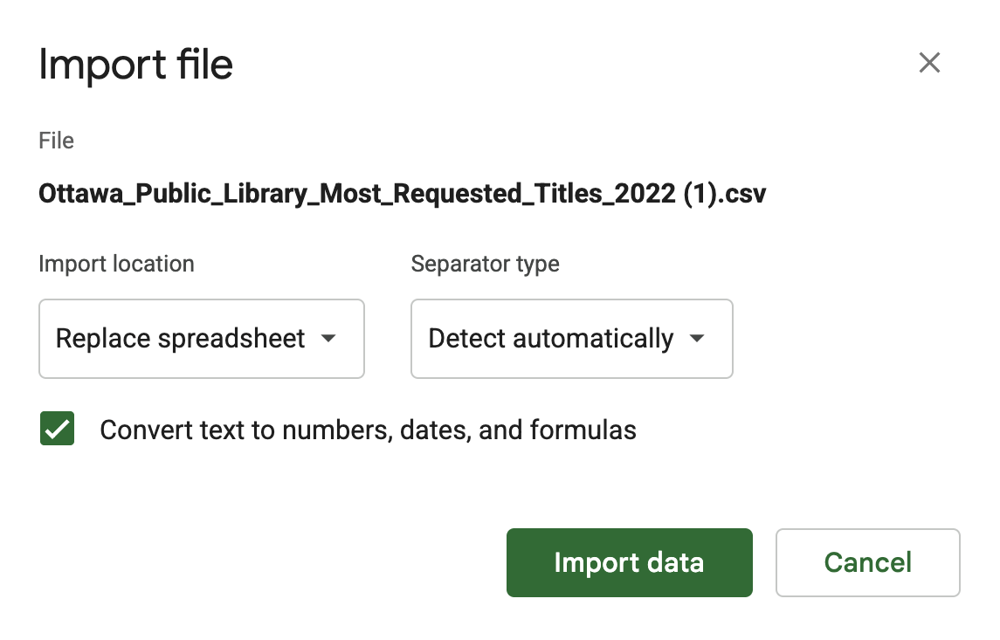   
*Figure 1: The "Import File" prompt on Google Sheets for the 2022 dataset.*
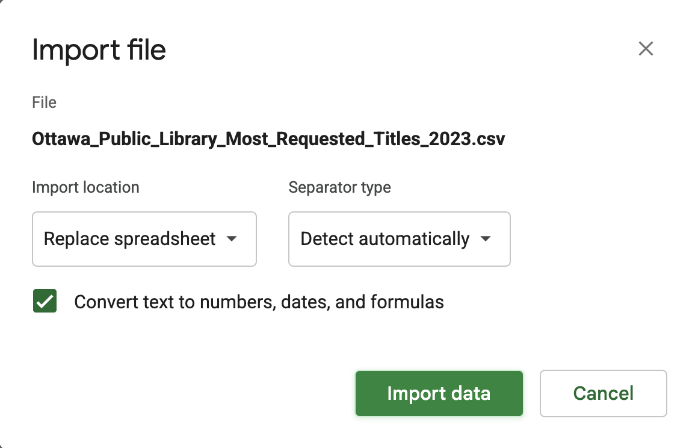   
*Figure 2: The "Import File" prompt on Google Sheets for the 2023 dataset.*
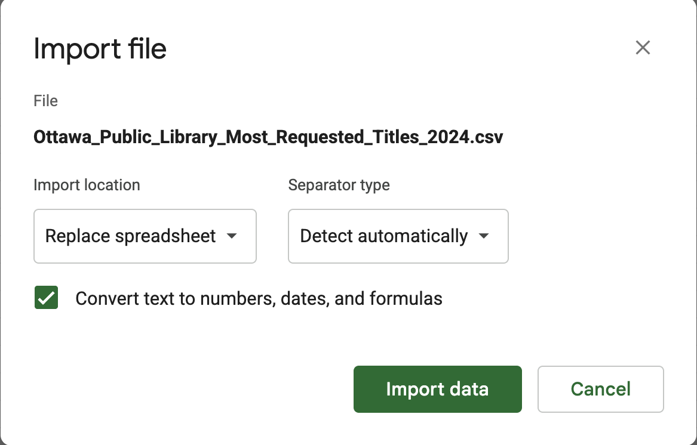   
*Figure 3: The "Import File" prompt on Google Sheets for the 2024 dataset.*
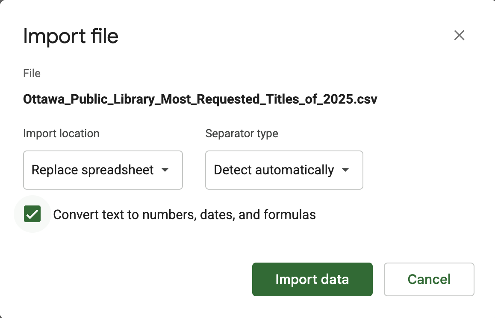   
*Figure 4: The "Import File" prompt on Google Sheets for the 2025 dataset.* 

The 2022 list of most requested titles has 57,050 rows (excluding the title row), and 13 columns. The data is relatively clean, but does have a few missing values in the author column (G).  

The 2023 list of most requested titles has 96,113 rows (excluding the title row), and 13 columns. This set is also very clean, but also has several missing values in column G (authors names). 

the 2024 list of most requested titles has 135,036 rows (excluding the title row), and 14 columns. There appear to far less missing values in column G, but there are certainly still empty slots. 

the 2025 list of most requested titles has 126,969 rows (excluding the title row), and 14 columns. Again, column G is missing a few values. 

The most relevant columns in all of these datasets will be columns D, which contains the book titles, and H, which contains the number of holds. 

I intend to compare these datasets to social media "reading lists" for the corresponding years, so I also located articles that listed the 2022, 2023, 2024, and 2025 most recommended titles on BookTok. I then opened up another empty google sheet file, and used the following commands: 
1. For the 2022 list: `=IMPORTHTML("https://mashable.com/article/most-read-books-2022-tiktok", "list")` 
2. For the 2023 list: `=IMPORTXML("https://www.usmagazine.com/entertainment/news/2023-booktok-recommendations-biggest-books-on-the-app/", "//h3[contains(text(), 'by') or contains(text(), 'Happy Place')]")` 
3. For the 2024 list: `=IMPORTXML("https://www.rollingstone.com/culture/culture-lists/booktok-best-books-2024-1235090973/piglet-by-lottie-hazel-1235203379/", "//h2")` 
4. For the 2025 list: `=IMPORTXML("https://www.kobo.com/blog/the-best-book-booktok-2025", "//h2")` 

## 2. Understanding Data

### 2.1. VIMO Analysis

According to the metadata, this information is provided by the Ottawa Public Library, and the contact is listed as OPL Finance and Business Services. 

As seen in Rohrer (2023), when you are attempting to estimate the prevalence of something, like BookTok influence in Ottawa, it's important to have a representative sample of the population of interest. In this case, we are interested in Ottawa readers, but unfortunately, these datasets exclude digital platforms like overdrive. 

This means that an entire demographic of readers, those borrowing on the Libby app, are not being represented in this data. Though it is unfortunate because I think that data would tell an interesting story about the increase of people borrowing audiobooks and reading digitially since COVID, I don't think it will significantly impact my intended story about how TikTok has influenced Ottawa readers as that is still evident in the hold statistics. 

Furthermore, I identified some interesting stories in my pitch that described Ottawa bookstores having an increased demand for certain titles and genres. This exploration would not require any data from Libby, as bookstores are only handling physical copies. 

Additionally, "estimating causal effects from observational data requires a lot of assumptions" (Rohrer, 2023) and that the "correlation you observe in your sample won't neccesarily be the correlation in the population." (Rohrer, 2023). This is important to consider as Ottawa readers could be being influenced by friends, family, neighbors, or coworkers as opposed to being persuaded directly by infleuncers on BookTok.

As mentioned previously, there are several missing values in the author column of each dataset. For example, the second title in the 2025 dataset, *Yellowstone*, does not name an author. Fortunately, no other columns in the first 100 rows are missing any information. 

### 2.2. Cleaning Data

I began by selecting the first 100 titles of each set, which I pasted into a new sheet (no longer attached to the import). I deleted all of the unnesecary columns for my intended story, which were Collection, Catalogue, Format, FID, and Object ID. I froze the first row, and bolded the titles of each column for clarity. 

The 2025 dataset was not organized from most requested to least requested like the others, so I had to sort the sheet by column F (amount of holds) Z-A so that it would display the title with the most holds of 2025 as the first item, and the rest in decreasing order. 

I filled in the missing author value in the 2025 list by searching up the Title and Item Title on my browser and finding the attributed author. 

Finally, I used find and replace to remove the slashes that appear after every item title, and made sure to identify the holds column as numbers with no visible decimal place. 

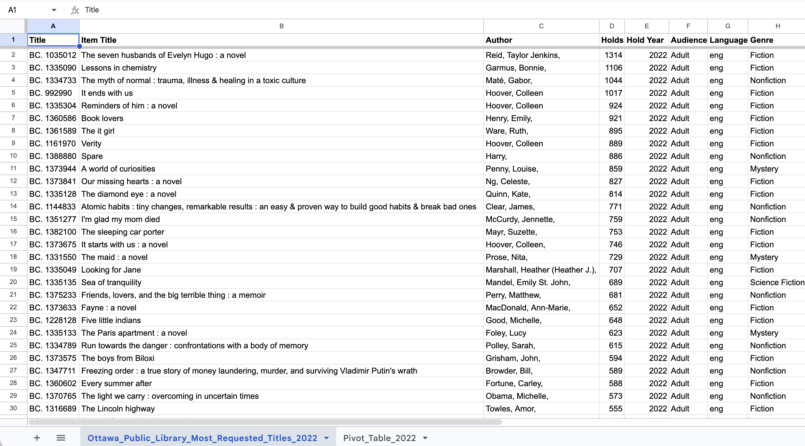   
*Figure 5: This screen capture shows the first 30 items in the cleaned 2022 Most Requested Titles dataset in Google Sheets.* 
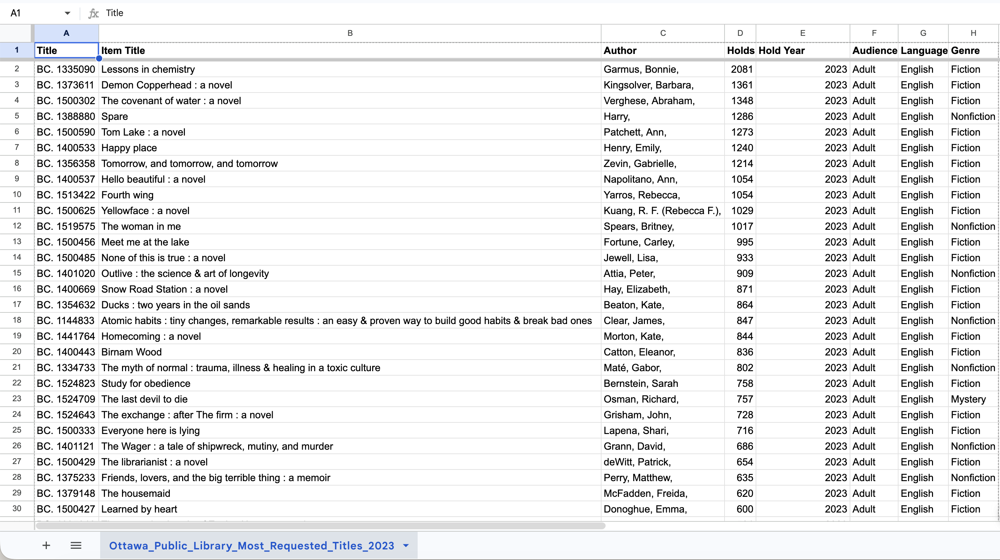   
*Figure 6: This screen capture shows the first 30 items in the cleaned 2023 Most Requested Titles dataset in Google Sheets.* 
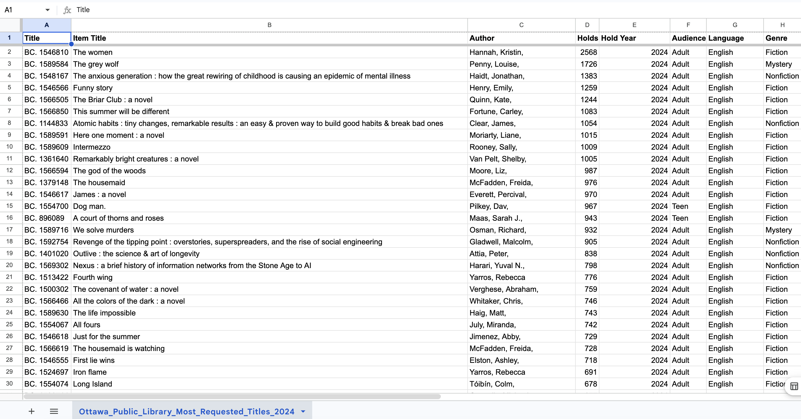   
*Figure 7: This screen capture shows the first 30 items in the cleaned 2024 Most Requested Titles dataset in Google Sheets.* 
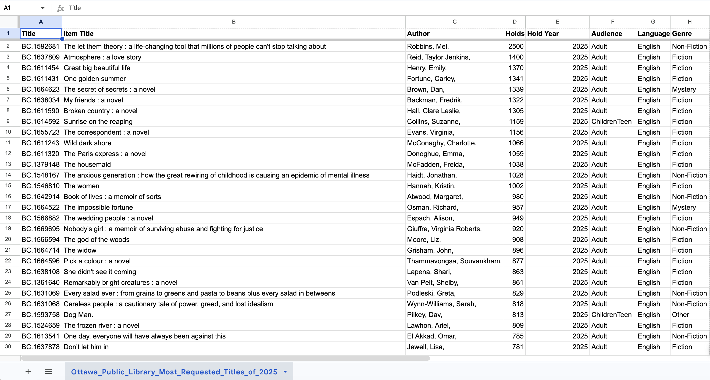   
*Figure 8: This screen capture shows the first 30 items in the cleaned 2025 Most Requested Titles dataset in Google Sheets.* 

I used `=SPLIT(A1, "by", FALSE)` on the 2022 and 2023 BookTok reading list imports to separate the title and authors names into two different columns for clarity and consistency with the other lists. 

### 2.3. Analyzing Data

For my pivot tables, I added Item Titles in rows, and Holds for the value. I sorted the rows in descending order by the sum of holds. I chose to use these values because for my intended story the item titles and number of times they were requested will be the most relevant for comparison. 

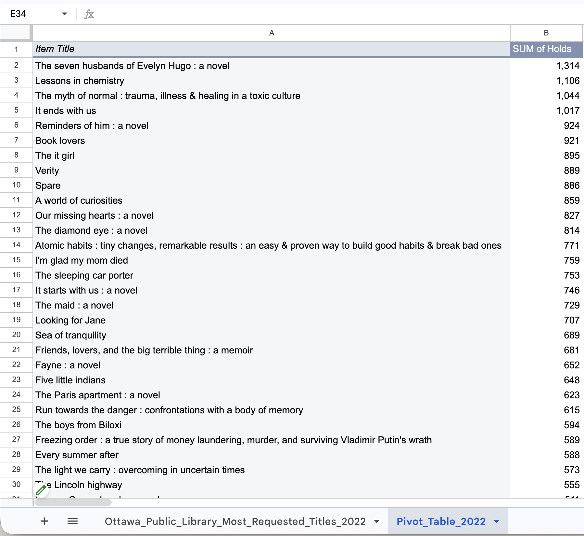 
*Figure 9: This pivot table shows the first 30 items of the 2022 most requested titles list sorted in descending order by sum of holds.*
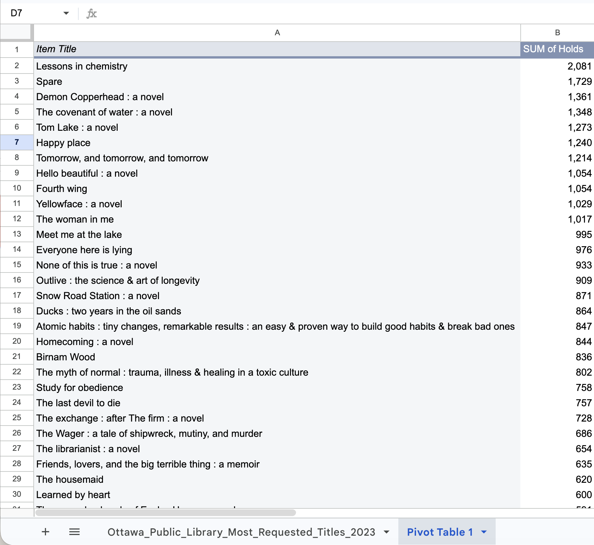 
*Figure 10: This pivot table shows the first 30 items of the 2023 most requested titles list sorted in descending order by sum of holds.*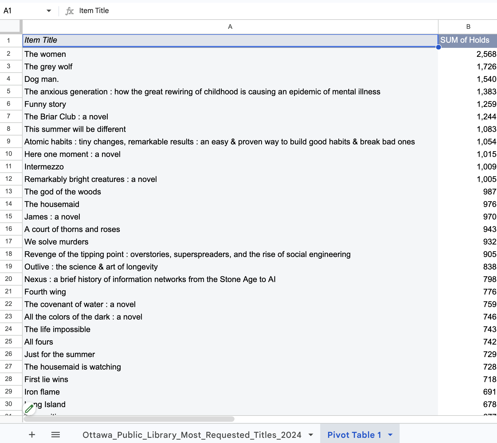 
*Figure 11: This pivot table shows the first 30 items of the 2024 most requested titles list sorted in descending order by sum of holds.*
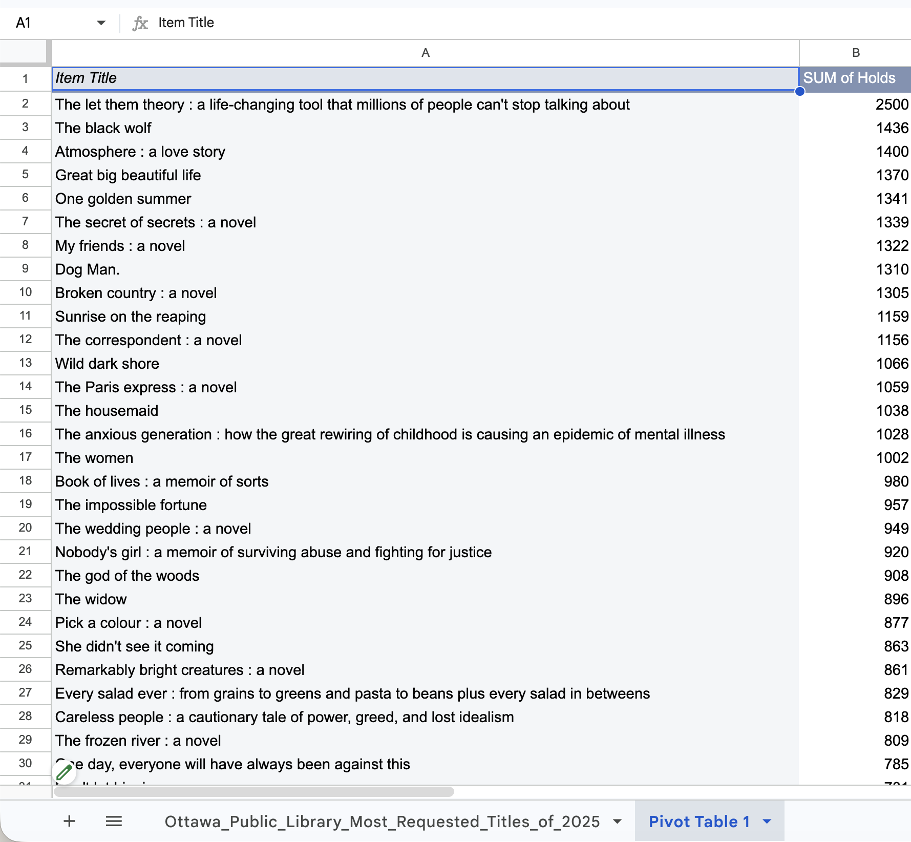 
*Figure 12: This pivot table shows the first 30 items of the 2025 most requested titles list sorted in descending order by sum of holds.*

For my exploratory charts I decided to sort it by prevelance of genre. If I choose to write my story about how the OPL has experienced a similar demand for certain genres as local bookstores, this visualization will aid significantly. 

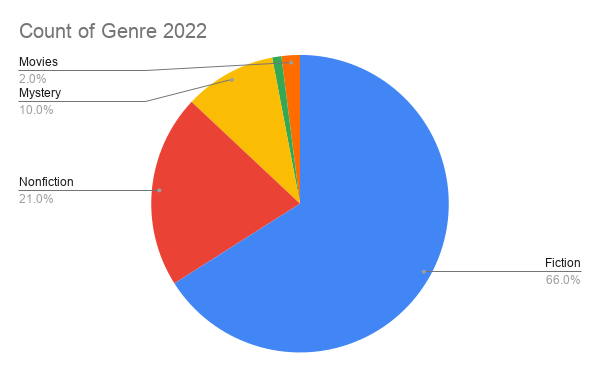 
*Figure 13: This exploratory chart shows the most common genres in the 2022 list of most requested titles.* 
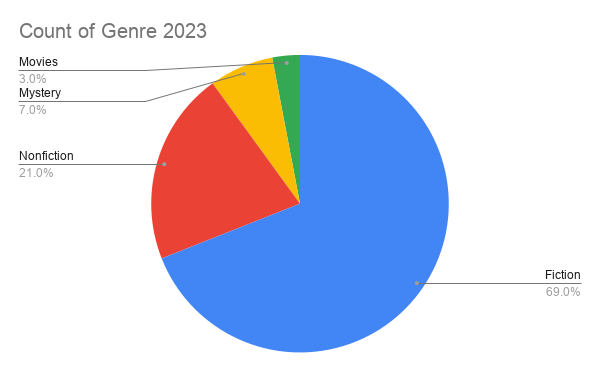 
*Figure 14: This exploratory chart shows the most common genres in the 2023 list of most requested titles.* 
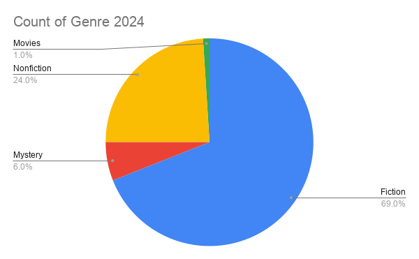 
*Figure 15: This exploratory chart shows the most common genres in the 2024 list of most requested titles.* 
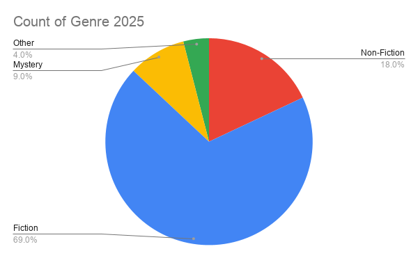 
*Figure 16: This exploratory chart shows the most common genres in the 2025 list of most requested titles.* 

## 3. Delivering Data

As mentioned, I think I have two logical paths I could take using these datasets. 
1. By comparing titles from BookTok reading lists to titles in the OPL most requested lists, I could explore the evident influence social media has had on the novels Ottawa readers are borrowing. It could shine a positive light on BookTok and how it contributed to the increase of readers during the pandemic. 
2. By comparing the most prevelant genres within the OPL most requested list with what local bookstores reportedly saw an increased demand in, I could explore how the popularization of certain genres has led to an increase in customers and borrowers at both the OPL and local bookstores. For example, Capital Current published a piece with testimony that some bookstores had "essentially doubled the amount of fiction books" in store (Guido & Hartmann, 2025), and the pie charts for all four years (2022-2025) have fiction as the most requested genre. 

To tell either of these stories, I feel I would need to find more consistent "reading lists" for the most popular BookTok titles from 2022-2025. Currently, my lists are different lenghts and I would ideally like a top 10 or top 20 for each year, but that might require I redownload TikTok and do my own investigating for some community compilation. 

Booktokbooks.com seems like it could be a valuable source for either of these stories. As an independent discovery catalog, they create unsponsored and non-affiliated reading guides by searching for themes associated with BookTok. Unfortunately, they do not have any reading lists for past years. 

## 4. References

Rohrer, Juilia. (2023). *Non-representative samples! What could possibly go wrong?*. The 100% CI. [https://www.the100.ci/2023/03/07/non-representative-samples-what-could-possibly-go-wrong/] 

Guido, C. & Hartmann, C. (2025). *BookTok turns a page in Ottawa's literary scene*. Capital Current. [https://capitalcurrent.ca/booktok-ottawa/]

BookTok Books. [https://booktokbooks.com/editorial-policy.php]